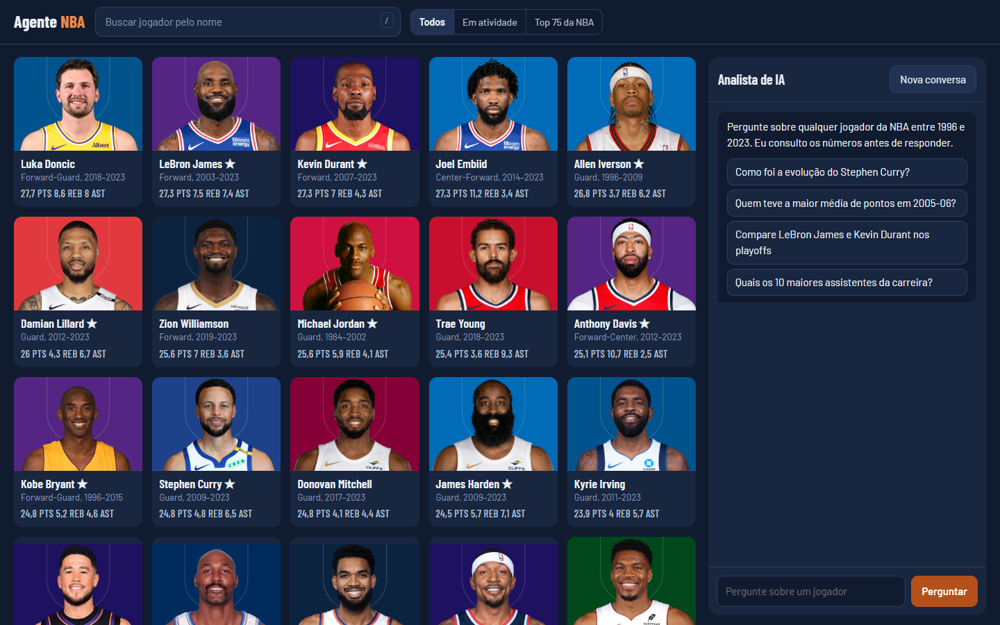
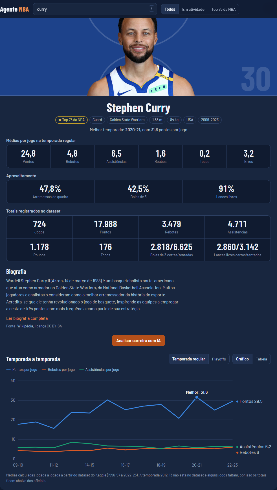
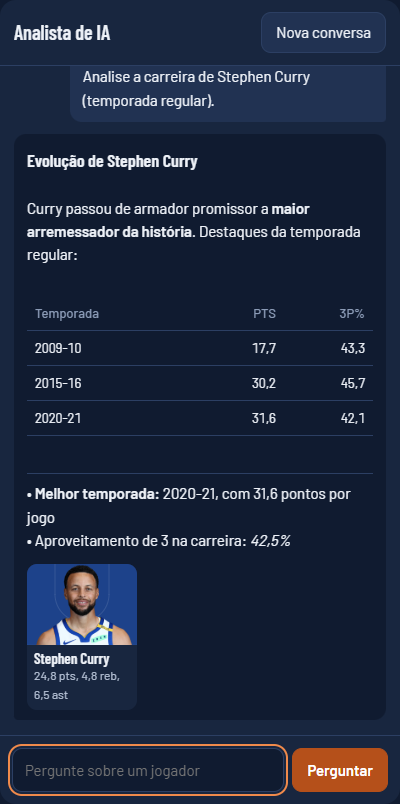
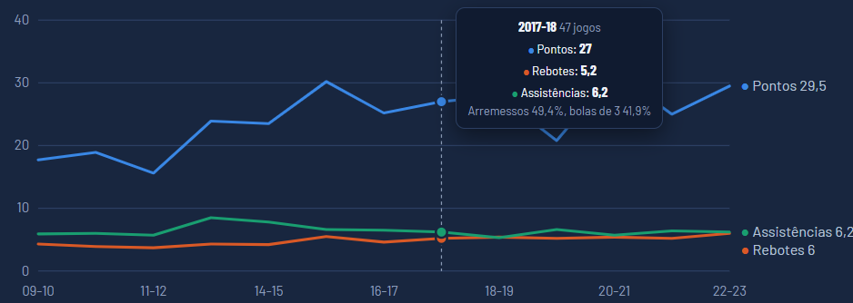
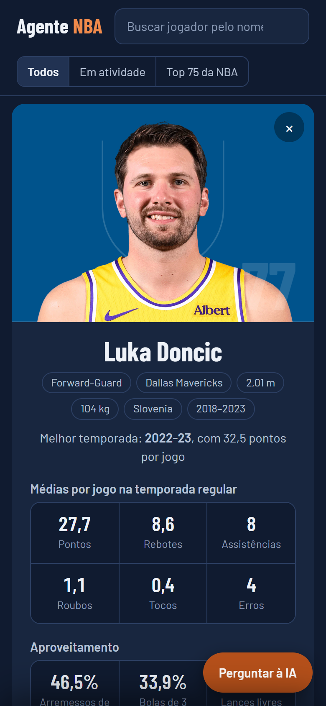
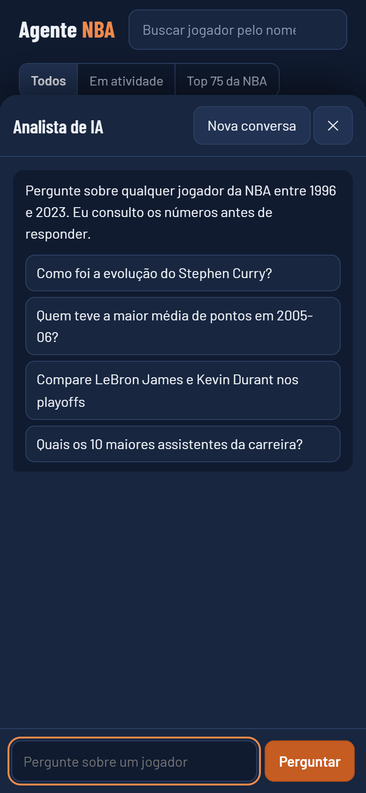
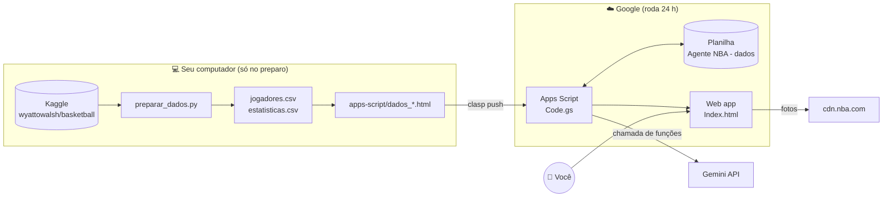
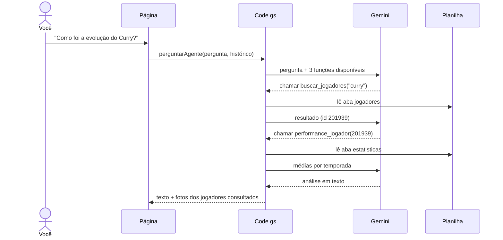
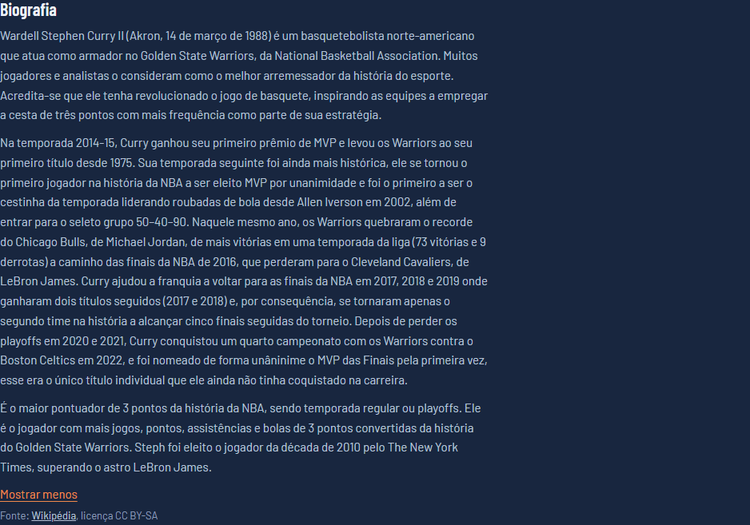

<div align="center">

# 🏀 Agente NBA

**Um app em Google Apps Script que mostra a performance de cada jogador da NBA com foto,
e tem um analista de IA (Google Gemini) que responde perguntas consultando os dados reais.**




</div>

---

## Sumário

- [O que o app faz](#o-que-o-app-faz)
- [Telas](#telas)
- [Como funciona por dentro](#como-funciona-por-dentro)
- [Os dados](#os-dados)
- [Instalação passo a passo](#instalação-passo-a-passo)
- [Chave do Gemini e segurança](#chave-do-gemini-e-segurança)
- [Estrutura do projeto](#estrutura-do-projeto)
- [Decisões de design e UX](#decisões-de-design-e-ux)
- [Desempenho](#desempenho)
- [Problemas comuns](#problemas-comuns)

---

## O que o app faz

| | Recurso | Detalhe |
|---|---|---|
| 🖼️ | **Galeria com foto** | Cerca de 2.200 jogadores com foto oficial da NBA sobre a cor do time, ordenados por pontos na carreira |
| 🔎 | **Busca instantânea** | Filtra enquanto você digita, com filtros *Em atividade* e *Top 75 da NBA* |
| 📋 | **Ficha completa** | Foto centralizada e, abaixo, médias por jogo, aproveitamento e totais |
| 📖 | **Biografia** | Introdução do artigo da Wikipédia de cada jogador; em português ou traduzida do inglês, com link da fonte |
| 📈 | **Evolução por temporada** | Gráfico interativo (passe o mouse) ou tabela, em temporada regular e playoffs |
| 🤖 | **Analista de IA** | O Gemini consulta os dados com chamada de funções e responde com as fotos dos jogadores citados |
| 📱 | **Celular** | Layout em uma coluna, com o chat numa gaveta |
| ☁️ | **Funciona com o PC desligado** | Tudo roda nos servidores do Google |

---

## Telas

<table>
<tr>
<td width="58%" valign="top">

**Ficha do jogador.** A foto aparece recortada sobre a cor do time, com as linhas da quadra
ao fundo e o número da camisa. Abaixo dela vêm todas as estatísticas. A melhor temporada
fica marcada no gráfico.



</td>
<td width="42%" valign="top">

**Analista de IA.** As respostas trazem tabelas e a foto de cada jogador consultado.
Clicar numa foto abre a ficha.



<sub>Captura do teste local. A resposta da IA nesta imagem é ilustrativa.</sub>

**Gráfico interativo**



</td>
</tr>
</table>

<table>
<tr>
<td align="center"><br><sub>Ficha no celular</sub></td>
<td align="center"><br><sub>Chat em gaveta no celular</sub></td>
</tr>
</table>

---

## Como funciona por dentro



**Ciclo do agente.** O Gemini não inventa números: ele pede ao app que execute funções
sobre a planilha e responde com base no resultado.



| Função do agente | O que devolve |
|---|---|
| `buscar_jogadores(termo)` | id, nome, posição, time e anos de carreira |
| `performance_jogador(person_id, fase)` | perfil, médias da carreira e de cada temporada |
| `biografia_jogador(person_id)` | introdução do artigo da Wikipédia (trajetória, prêmios, títulos) |
| `ranking_jogadores(estatistica, temporada, limite)` | líderes por média; percentuais exigem um mínimo de tentativas, como na NBA |

---

## Os dados

O dataset [wyattowalsh/basketball](https://www.kaggle.com/datasets/wyattowalsh/basketball) não traz
estatísticas por jogador prontas. O `preparar_dados.py` as calcula **jogada a jogada**
a partir do `play_by_play.csv` (2,2 GB):

| Evento no play-by-play | Vira |
|---|---|
| Arremesso certo / errado (com "3PT" na descrição) | pontos, FGM/FGA, 3PM/3PA |
| Lance livre (sem "MISS") | pontos, FTM/FTA |
| Rebote de jogador | rebotes |
| Arremesso certo com `player2` | assistência para o `player2` |
| Erro (turnover) com `player2` | erro para o `player1`, roubo para o `player2` |
| Arremesso errado com `player3` | toco para o `player3` |

**Precisão.** As médias por jogo batem com as oficiais:

| Jogador | Temporada | Calculado | Oficial |
|---|---|---|---|
| Kobe Bryant | 2005-06 | 35,5 pts | 35,4 pts |
| Stephen Curry | 2015-16 | 30,2 pts | 30,1 pts |

> [!NOTE]
> **Cobertura:** temporadas 1996-97 a 2022-23. A **2012-13 não existe no dataset**, e cerca de
> 15% dos jogos de cada temporada estão faltando. Por isso o app (e o agente) dão prioridade às
> médias por jogo, que são confiáveis. Totais e número de jogos ficam abaixo dos oficiais.

### Biografias

O `biografias.py` consulta o **Wikidata** pelo id oficial da NBA (propriedade `P3647`), o mesmo
id do dataset. Assim cada jogador é ligado ao artigo exato, sem confundir homônimos.

| Jogadores | Com artigo em português | Só em inglês (traduzido) |
|---|---|---|
| 2.167 | 1.253 | 914 |

No app, a introdução do artigo é buscada na hora e guardada em cache. Artigos que só existem
em inglês são traduzidos pelo `LanguageApp`, o tradutor do próprio Google Apps Script.
O texto da Wikipédia é licenciado em CC BY-SA, por isso a ficha sempre mostra o link da fonte.



As fotos vêm do CDN oficial da NBA pelo id do jogador:
`https://cdn.nba.com/headshots/nba/latest/1040x760/{person_id}.png`.

---

## Instalação passo a passo

### 1. Gerar os dados (no seu PC, uma vez)

```bash
python -m venv .venv
.venv/Scripts/pip install pandas kagglehub          # Linux/Mac: .venv/bin/pip
.venv/Scripts/python -c "import kagglehub; [kagglehub.dataset_download('wyattowalsh/basketball', path=f, output_dir='dataset') for f in ['csv/common_player_info.csv', 'csv/play_by_play.csv']]"
.venv/Scripts/python preparar_dados.py dataset   # também liga os jogadores à Wikipédia
```

Para atualizar só as biografias, sem recalcular as estatísticas: `.venv/Scripts/python biografias.py`.

O script gera `saida/*.csv` e copia os dados para `apps-script/dados_*.html`, que vão junto
com o código.

### 2. Configurar a chave do Gemini

Crie a chave em [aistudio.google.com/apikey](https://aistudio.google.com/apikey) e copie o modelo:

```bash
cp docs/chave.exemplo.gs apps-script/chave.gs   # depois cole a chave dentro dele
```

### 3. Enviar para o Google com o clasp

```bash
npx @google/clasp login                       # uma vez, abre o navegador
npx @google/clasp push --force                # envia o código (o .clasp.json aponta o projeto)
npx @google/clasp deploy -d "primeira versão" # cria o web app
```

Para **atualizar sem mudar a URL**, reutilize o id da implantação:

```bash
npx @google/clasp list-deployments
npx @google/clasp deploy -i <ID_DA_IMPLANTACAO> -d "descrição da mudança"
```

### 4. Primeiro acesso

Abra a URL do web app e autorize as permissões. No primeiro carregamento, que leva cerca de 30 s,
o app cria a planilha **"Agente NBA - dados"** no seu Drive e importa tudo sozinho.

---

## Chave do Gemini e segurança

| Onde a chave pode ficar | Vai para o Git? | Vai para o Apps Script? |
|---|---|---|
| `apps-script/chave.gs` | ❌ não (está no `.gitignore`) | ✅ sim, pelo `clasp push` |
| Propriedade de script `GEMINI_API_KEY` | ❌ não | ✅ sim, com prioridade sobre o arquivo |
| `docs/chave.exemplo.gs` | ✅ sim, mas só com o texto `COLE_SUA_CHAVE_AQUI` | ❌ não |

> [!WARNING]
> O web app vem configurado para acesso **só seu** (`"access": "MYSELF"` no `appsscript.json`).
> Se liberar para outras pessoas, cada pergunta no chat usa a **sua** cota do Gemini.

Antes de um commit, para conferir que nenhuma chave vai junto:

```bash
git ls-files --others --exclude-standard --cached | xargs grep -lE "AQ\.[A-Za-z0-9_-]{30,}|AIza[A-Za-z0-9_-]{30,}" || echo "nenhuma chave"
```

---

## Estrutura do projeto

```
Agentes_atualiaveis/
├── preparar_dados.py          # Kaggle → CSVs (estatísticas calculadas do play-by-play)
├── biografias.py              # liga cada jogador ao artigo da Wikipédia (via Wikidata)
├── .clasp.json                # liga a pasta apps-script/ ao projeto no Google
├── apps-script/               # tudo aqui vai para o Apps Script com "clasp push"
│   ├── Code.gs                # backend: planilha, cache, funções do agente, Gemini
│   ├── Index.html             # interface: galeria, ficha, gráfico, chat
│   ├── appsscript.json        # permissões e configuração do web app
│   ├── dados_jogadores.html   # dados embutidos (importados no 1º acesso)
│   ├── dados_estatisticas.html
│   └── chave.gs               # 🔒 chave do Gemini (fora do Git)
└── docs/                      # capturas de tela e o modelo chave.exemplo.gs
```

---

## Decisões de design e UX

A interface foi desenhada para o tema do app, o basquete:

| Decisão | Motivo |
|---|---|
| **Foto sobre a cor do time, com linhas da quadra** | É o elemento marcante, como uma figurinha. As fotos da NBA têm fundo transparente |
| **Barlow Condensed** para nomes e números | Lembra numeração de camisa e placar; os números usam largura fixa para alinhar |
| **Azul-marinho de ginásio**, laranja só em ações | O laranja da bola indica onde clicar |
| **Cores do gráfico validadas** | Testadas para daltonismo e contraste sobre o fundo |
| **Sem caixa alta e sem texto decorativo** | Títulos dizem o que o bloco mostra; erros dizem o que fazer |

**Detalhes de uso:**

- ⌨️ `/` vai para a busca, `Esc` fecha a ficha ou o chat.
- ⚡ Parar o mouse sobre um card já carrega a ficha antes do clique.
- ⏳ Enquanto o Gemini trabalha, o chat mostra a etapa atual (uma resposta leva de 15 a 60 s).
- 💾 A conversa continua depois de recarregar a página.
- 📏 Altura e peso aparecem em metros e quilos.
- ♿ O foco do teclado fica visível, os botões têm rótulos para leitores de tela e o movimento é reduzido para quem prefere.

---

## Desempenho

| Camada | Técnica |
|---|---|
| Servidor (uma execução) | A planilha é lida uma vez e reaproveitada por todas as funções do agente |
| Servidor (entre execuções) | `CacheService` por 6 h para fichas e rankings, invalidado a cada importação |
| Navegador | Fichas e buscas já feitas não chamam o servidor de novo; pedidos iguais em andamento são compartilhados |
| Gemini | Se o modelo responder 503 ou 429, o app tenta de novo e cai para `gemini-3.5-flash-lite` |
| Imagens | Carregamento sob demanda na galeria e prioridade alta na foto da ficha |

---

## Problemas comuns

| Mensagem | Causa | Solução |
|---|---|---|
| *Preparando os dados do primeiro acesso…* | A planilha está sendo criada | Aguarde cerca de 30 s; só acontece uma vez |
| *Erro da API do Gemini (503)* | Alta demanda nos servidores do Google | O app já tenta outros modelos; repita em alguns segundos |
| *Erro da API do Gemini (400/403)* | Chave inválida ou sem permissão | Gere outra chave e atualize o `chave.gs` ou a propriedade `GEMINI_API_KEY` |
| *Defina GEMINI_API_KEY…* | Falta a chave | Veja [Chave do Gemini e segurança](#chave-do-gemini-e-segurança) |
| Mudanças não aparecem na URL | A implantação aponta para uma versão antiga | `clasp deploy -i <ID>` para atualizar a mesma URL |
| *Biografia indisponível* | O artigo não pôde ser lido agora | Use "Tentar de novo" na ficha |
| Foto com silhueta | Jogador sem foto no CDN da NBA | Normal para alguns jogadores antigos |

---

<div align="center">
<sub>Dados: <a href="https://www.kaggle.com/datasets/wyattowalsh/basketball">Kaggle wyattowalsh/basketball</a> | Fotos: NBA.com | IA: Google Gemini</sub>
</div>
Link do Proeto:
https://script.google.com/macros/s/AKfycbxT9CaMSY7RgzVili2RFphbmQQG4v1WdfjhKCWUdZAmr-WloGE02BytxfFdbQJgZcO19Q/exec